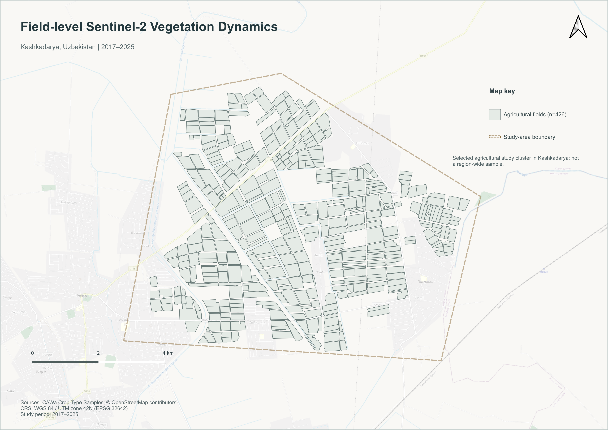
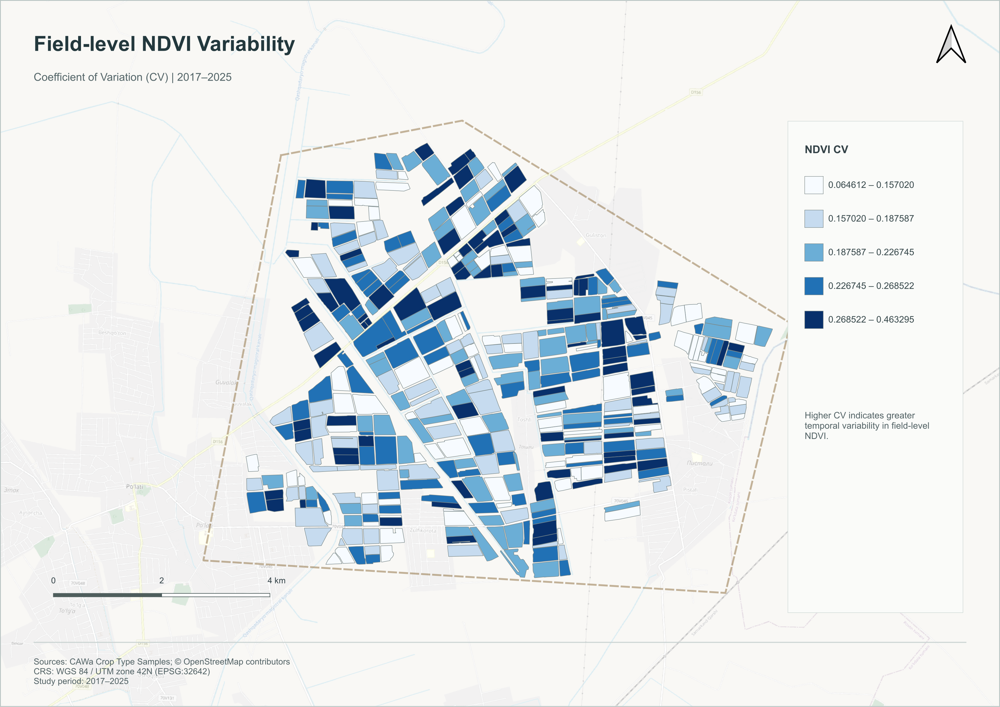
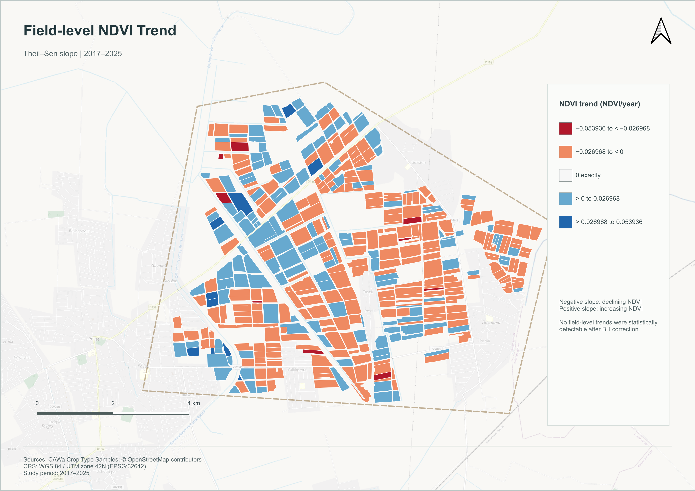
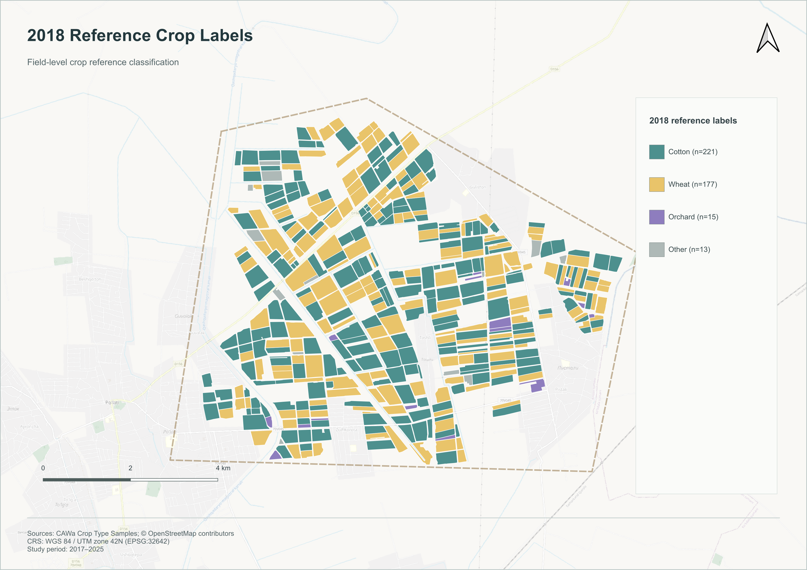

# Field-level Sentinel-2 Vegetation Dynamics in Kashkadarya, Uzbekistan

**Study period:** 2017–2025  
**Study design:** Pilot study  
**Study units:** 426 agricultural fields in one selected agricultural study cluster

This project uses multi-temporal Sentinel-2 imagery to characterize field-level vegetation dynamics and examines statistical associations between annual vegetation conditions and climate variability in Kashkadarya, Uzbekistan.

## Key Findings

- **426 agricultural fields** were analysed over 2017–2025.
- Field-level NDVI variability was characterized using the coefficient of variation (CV) and visualized using five quantile classes.
- No individual field-level NDVI trends were statistically detectable after Benjamini–Hochberg (BH) correction. This does not mean that all fields remained unchanged.
- Winter precipitation (October–April) was the only predefined primary climate variable showing an association with annual NDVI that passed the significance threshold after Bonferroni correction (Spearman ρ = 0.933, n = 9 years; adjusted p ≈ 0.00225).
- The positive winter-precipitation association remained strong in sensitivity analysis excluding 2017 and in a partial rank-based analysis controlling for year. The partial-analysis p-value is approximate.
- Growing-season precipitation did not meet the predefined stability criterion in the 2018–2025 sensitivity analysis (|Δρ| = 0.214).

**Scope:** This pilot study concerns one selected agricultural cluster. The 426 fields must not be interpreted as representative of the entire Kashkadarya Region.

## Research Objective

To identify and characterize agricultural fields using multi-temporal Sentinel-2 imagery, meteorological data, and geospatial analysis, and to quantify differences in crop condition and temporal behaviour at field level.

### Research Question

How has the condition of agricultural fields in the selected study cluster changed over time, and to what extent are observed field-level changes associated with temperature and precipitation variability?

## Study Area and Data

The study covers 426 agricultural field polygons in a selected agricultural cluster in Kashkadarya, Uzbekistan.

| Dataset | Purpose | Source |
|---|---|---|
| CAWa Crop Type Samples | Field selection and crop-reference information | [CAWa dataset](https://doi.org/10.6084/m9.figshare.12047478.v2) |
| Sentinel-2 Surface Reflectance | Vegetation index calculation | `COPERNICUS/S2_SR_HARMONIZED` |
| Cloud Score+ | Cloud and observation screening | `GOOGLE/CLOUD_SCORE_PLUS/V1/S2_HARMONIZED` |
| ERA5-Land | Climate variables | [Copernicus Climate Data Store](https://cds.climate.copernicus.eu/datasets/reanalysis-era5-land) |
| CHIRPS Daily | Precipitation | [Climate Hazards Center](https://chc.ucsb.edu/data/chirps/) |
| OpenStreetMap | Cartographic background | [OpenStreetMap copyright](https://www.openstreetmap.org/copyright) |

See [`data/README.md`](data/README.md) for data availability and attribution notes.

## Methodology

### Google Earth Engine

Sentinel-2 Surface Reflectance imagery was processed using the harmonized collection `COPERNICUS/S2_SR_HARMONIZED`. Cloud Score+ (`cs_cdf`) was used for observation screening with a threshold of 0.60.

The spectral indices calculated were:

- **NDVI** — Normalized Difference Vegetation Index
- **NDMI** — Normalized Difference Moisture Index
- **EVI** — Enhanced Vegetation Index

Monthly median composites were generated, and field-level statistics were extracted for the 426 agricultural polygons. Annual CSV exports cover 2017–2025.

### Python / Jupyter

The field-level workflow includes data quality control, monthly data preparation, annual NDVI metrics, coefficient of variation, Theil–Sen slope estimation, statistical testing, multiple-testing correction, crop-reference summaries, and supporting diagnostics.

The final common-month growing-season metric, `NDVI_mean_gs_common`, is used for the relevant annual field-level analysis.

### Climate Analysis in R

Annual vegetation metrics were integrated with climate variables. The analysis includes Spearman rank correlations, Bonferroni correction, sensitivity analysis excluding 2017, leave-one-year-out analysis, relationships with year, and partial rank-based analysis controlling for year.

The climate analysis uses nine annual observations (2017–2025).

### QGIS

Four print layouts communicate the spatial results. The project CRS is WGS 84 / UTM zone 42N (EPSG:32642).

## Results

### Map 1 — Study Area

Shows the selected agricultural study cluster and the 426 field polygons used in the analysis.

[PDF version](results/maps/Map01_Study_Area.pdf)

### Map 2 — NDVI Variability

Displays the field-level coefficient of variation (CV) using five quantile classes. CV describes temporal variability and is not interpreted as evidence of degradation.

[PDF version](results/maps/Map02_NDVI_Variability.pdf)

### Map 3 — NDVI Trend

Displays field-level Theil–Sen slopes using a diverging colour scale centred at zero.

No field-level trends were statistically detectable after BH correction. This does not establish that no practical change occurred.

[PDF version](results/maps/Map03_NDVI_Trend.pdf)

### Map 4 — 2018 Reference Crop Labels

The reference layer contains four display classes:

| Display class | Fields |
|---|---:|
| Cotton | 221 |
| Wheat | 177 |
| Orchard | 15 |
| Other | 13 |
| **Total** | **426** |

Crop-reference labels are available for 2018 only and do not constitute a multi-year crop-rotation classification.

[PDF version](results/maps/Map04_Crop_Reference_2018.pdf)

## Climate Associations

Winter precipitation (October–April) had a strong positive association with annual NDVI across the nine-year series (Spearman ρ = 0.933). It was the only predefined primary climate variable that passed the significance threshold after Bonferroni correction.

The association remained strong in sensitivity analysis excluding 2017 and in a partial rank-based analysis controlling for year. The partial-analysis p-value is approximate.

Temperature and growing-season precipitation did not pass the predefined multiple-testing significance threshold. Growing-season precipitation also did not meet the predefined stability criterion in the 2018–2025 sensitivity analysis.

These are observational statistical associations, not evidence of causality.

## Limitations

- **Short climate time series:** nine annual observations.
- **Spatial scope:** one selected agricultural cluster, not the entire region.
- **Crop-reference coverage:** 2018 only.
- **Irrigation data:** field-level irrigation records were unavailable.
- **Observation gap:** May 2017 had no complete Sentinel-2 observations in the processed collection.
- **Observation counts:** `scene_count` represents monthly scene availability at the study-cluster level, not a field-specific count of valid observations.
- **Climate resolution:** ERA5-Land represents gridded reanalysis data and does not resolve every individual field's conditions.
- **Statistical inference:** correlations do not demonstrate causality. The partial Spearman p-value is approximate, and n = 9 limits statistical power and generalizability.
- **Trend detection:** failure to detect statistically significant trends after multiple-testing correction does not imply that no changes occurred.

## Reproducibility and Data Availability

The project workflow is organized as:

**Google Earth Engine → Python / Jupyter → R → QGIS**

The public GEE scripts use a placeholder for the study-field asset path. Re-running the workflow requires a valid Earth Engine asset created from appropriately obtained study-field data.

The QGIS project depends on its associated spatial layers. Consult the project files and data documentation before reproducing the maps.

Third-party data retain their own licensing and attribution requirements. A dataset's inclusion in the analysis does not automatically permit its unrestricted redistribution.

## Repository Structure

- `gee/` — Google Earth Engine scripts
- `notebooks/` — field-level analysis in Python/Jupyter
- `scripts/` — climate analysis in R
- `data/` — source and processed datasets
- `results/figures/` — analytical figures
- `results/tables/` — analytical tables
- `results/maps/` — final map exports
- `qgis/` — QGIS project

## Software

- Google Earth Engine (JavaScript)
- Python / Jupyter
- R
- QGIS

Only software and methods actually used in this project are listed.
